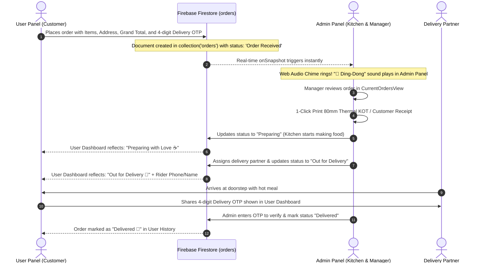

# 🔔 AGF CAFE — End-to-End Order Synchronization & Admin Orders Blueprint
> **Reference Analysis:** `the-grocery-hub-dashboard` (`CurrentOrdersView.jsx` & `OrderHistoryView.jsx`)  
> **Target Application:** `AGF-CAFE` (User Panel Checkout ➔ Firestore ➔ Admin Real-time Orders Management)

---

## 🏗️ 1. End-to-End Order Flow Architecture



---

## 🔍 2. Deep Analysis of Reference Views (`the-grocery-hub-dashboard`)

### A. Live Current Orders View (`CurrentOrdersView.jsx`)

1. **Audio Ping Chime on New Orders (`playOrderPingChime`)**:
   - Synthesizes a high-frequency sine-wave chime using the browser's native **Web Audio API** (`659.25 Hz` ➔ `880 Hz`).
   - No external `.mp3` file needed, zero latency, runs instantly on any browser.
   - Whenever `docChanges().some(change => change.type === 'added')` occurs in the Firestore listener, the chime rings.

2. **Order Lifecycle Status Pipeline**:
   - **`Order Received` / `Pending`** ➔ Newly arrived orders waiting for manager approval.
   - **`Preparing` / `Kitchen`** ➔ Kitchen is brewing coffee and preparing dishes.
   - **`Out for Delivery`** ➔ Assigned to delivery executive with partner name & phone.
   - **`Delivered`** ➔ Completed orders verified by OTP.
   - **`Cancelled`** ➔ Cancelled by customer or admin with documented reason.

3. **Status Filter Tabs**:
   - Filter pills showing live order counts:
     - `All ({count})`
     - `Order Received ({count})`
     - `Preparing in Kitchen ({count})`
     - `Out for Delivery ({count})`

4. **Action Controls on Every Order Card**:
   - **Stage Transition Button**: 1-click status advancement (`Accept Order ➔ Send to Kitchen ➔ Dispatch`).
   - **Assign Delivery Partner**: Modal / dropdown to assign staff member with mobile number.
   - **80mm Thermal Receipt Print**: Instant popup rendering the POS thermal receipt with hidden iframe printing.
   - **OTP Verification Modal**: At handover, admin verifies customer's 4-digit delivery PIN before marking `Delivered`.
   - **Delay Order Notification**: Quick dropdown to select preset delay reason (*Rain*, *Heavy traffic*, *High kitchen rush*) or custom note.
   - **Cancel Order**: Cancel with reason selection (*Out of ingredients*, *Customer request*, *Unserviceable area*).

---

### B. Order History View (`OrderHistoryView.jsx`)

1. **Comprehensive Data Table**:
   - Table columns: Order ID, Date & Time, Customer Name & Mobile, Items summary, Total Amount (₹), Payment Mode (COD / Online), Order Status, and Actions.
2. **Multi-Parameter Search & Filters**:
   - Instant text search matching Order ID, Customer Name, Phone, and Delivery Address.
   - Status Filter dropdown (`All`, `Delivered`, `Cancelled`).
   - Date Filter (`YYYY-MM-DD`) with local timezone parsing.
3. **Actions on Historical Orders**:
   - **View Full Details Modal**: Complete list of items, portions, add-ons, subtotal, discounts, and customer notes.
   - **Reprint Receipt**: Print receipt on thermal paper anytime.
   - **Export to CSV**: Download orders history as an Excel/CSV spreadsheet.

---

### C. Thermal Receipt Engine (`ThermalReceiptModal.jsx`)

1. **80mm Thermal POS Print Spec**:
   - Configured specifically for 80mm thermal receipt roll printers via standard `@media print`.
   - Uses zero-margin layout, Courier monospace font, dashed borders, and clear itemized table.
2. **Hidden Iframe Printing**:
   - Injects the receipt HTML into an invisible `<iframe>` and triggers `iframe.contentWindow.print()`.
   - **Result:** The admin screen does not reload, flicker, or navigate away!

---

## 🗄️ 3. Synchronized Firestore Schema (`orders` Collection)

To ensure **100% interoperability** between the **User Panel** and the **Admin Panel**, both panels read and write the exact same document structure:

```typescript
interface FirestoreCafeOrder {
  id: string;                      // Firestore Auto Document ID
  orderId: string;                 // Human readable e.g. "AGF-491028"
  userId: string | null;           // Customer Auth UID
  customerEmail: string | null;
  customerName: string;            // e.g. "Aman Kumar"
  customerPhone: string;           // e.g. "+91 98765 43210"
  deliveryAddress: string;         // e.g. "Flat 302, Green Avenue, Main Road, Baharagora 832101"
  shippingAddress?: {
    fullName: string;
    phone: string;
    street: string;
    locality?: string;
    city: string;
    pincode: string;
  };
  paymentMethod: 'COD' | 'ONLINE' | 'UPI';
  paymentStatus: 'PAID' | 'PENDING' | 'REFUNDED';
  items: Array<{
    id: string;
    name: string;
    price: number;
    quantity: number;
    image: string;
    portion?: string;
    notes?: string;
  }>;
  grandTotal: number;              // Total amount e.g. 450
  totalAmount: number;             // Same as grandTotal
  deliveryFee: number;
  discountAmount?: number;
  status: 'Order Received' | 'Preparing' | 'Out for Delivery' | 'Delivered' | 'Cancelled';
  deliveryOtp: string;             // 4-digit verification code e.g. "7284"
  assignedPartnerName?: string;
  assignedPartnerPhone?: string;
  delayNotice?: string;
  cancelReason?: string;
  createdAt: any;                  // serverTimestamp()
  updatedAt: any;
}
```

---

## 🛠️ 4. Concrete Implementation Plan for AGF CAFE Admin

```
c:\Users\ghosh\AGF-CAFE\admin\src\
│
├── context/
│   └── AdminOrdersContext.jsx       # Real-time listener for orders + Web Audio Chime alert
│
├── components/
│   ├── orders/
│   │   ├── CurrentOrdersView.jsx    # Live active orders pipeline with stage actions
│   │   ├── OrderHistoryView.jsx     # Historical orders table with search & date filters
│   │   ├── OrderDetailsModal.jsx    # Complete customer & items detail inspector
│   │   ├── ThermalReceiptModal.jsx  # 80mm POS receipt generator with hidden iframe print
│   │   ├── AssignPartnerModal.jsx   # Select delivery rider + phone
│   │   └── CancelOrderModal.jsx     # Cancel order with reason selector
│
└── App.jsx                          # Hook up activeTab === 'orders' in Sidebar & Header
```

---

## ⚡ 5. Step-by-Step Action Checklist

1. **User Panel Checkout Optimization**:
   - Ensure `user/src/features/cart/components/CheckoutModal.jsx` generates a 4-digit `deliveryOtp` and writes `totalAmount`, `grandTotal`, and `status: 'Order Received'` to Firestore.
2. **Admin Real-Time Orders Context**:
   - Create `AdminOrdersContext.jsx` with `onSnapshot(collection(db, 'orders'))` and the `playOrderPingChime()` sound generator.
3. **Current Orders View (`CurrentOrdersView.jsx`)**:
   - Build active order pipeline with `Order Received` ➔ `Preparing` ➔ `Out for Delivery` ➔ `Delivered`.
   - Add OTP verification modal for handover.
4. **Order History View (`OrderHistoryView.jsx`)**:
   - Build the searchable, filterable history table with CSV export.
5. **Thermal POS Receipt Printer**:
   - Integrate `ThermalReceiptModal.jsx` with hidden iframe printing.
6. **Sidebar Navigation**:
   - Connect `activeTab === 'orders'` in `App.jsx` with a live unread order badge count.
