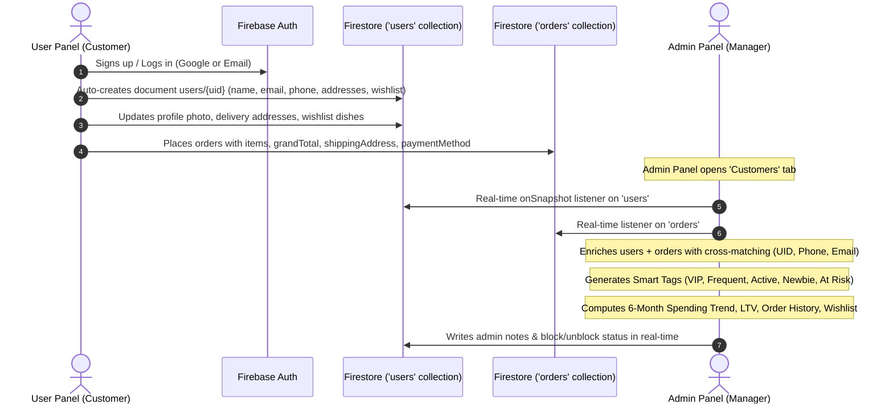

# 👥 AGF CAFE — Admin Users & Customer Management Blueprint
> **Reference Analysis:** `the-grocery-hub-dashboard/src/views/UsersView.jsx`  
> **Target Application:** `AGF-CAFE` (User Panel Data Storage ➔ Firestore ➔ Admin Customers Panel)  
> **Key Constraint:** **Referral System is completely excluded** (No referral codes, counts, or tabs).

---

## 🏗️ 1. Architecture & End-to-End Data Storage Flow



---

## 🔍 2. Deep Analysis of Reference View (`the-grocery-hub-dashboard/src/views/UsersView.jsx`)

### A. Core Capabilities in Grocery Hub
1. **Dual Source Enrichment:**
   - Reads registered users from Firestore `users` collection.
   - Reads all orders from Firestore `orders` collection.
   - Merges registered profiles with guest order customers using a 3-way matcher:
     - `UID` match
     - Clean 10-digit phone match (`digits.slice(-10)`)
     - Normalized email match (`email.toLowerCase()`)
   - Backfills missing or generic names (`"Customer"`, `"User"`) with real customer names extracted from shipping addresses.

2. **Smart Customer Segmentation Tags:**
   - **VIP:** Total spend >= ₹5,000 or Total orders >= 15.
   - **Frequent:** Total orders >= 5.
   - **Active:** Ordered within the last 7 days.
   - **Newbie:** Joined within 14 days and has 0 orders.
   - **At Risk:** Ordered previously, but has had 0 orders in the last 30+ days.

3. **Metrics Bar:**
   - Total Customers (registered + guest customers).
   - Active Customers (customers with at least 1 order).
   - Total Customer Lifetime Revenue (₹).
   - Average Spend per Customer (₹).

4. **Multi-Parameter Search & Sort:**
   - Instant search across Name, Phone, Email, and Customer ID.
   - Filter by: `All`, `Active`, `Inactive`, `Registered`.
   - Sort by: `Newest Joined`, `Oldest Joined`, `Most Orders`, `Highest Spend`, `Name (A-Z)`.
   - CSV Export of customer directory.

5. **Customer Detail Modal (`SelectedUserModal`):**
   - **Account Controls:** Block / Unblock user toggle (persisted to Firestore).
   - **Contact & Addresses:** Phone with click-to-call, Email with click-to-email, full primary address and multi-address book with Home/Work tags.
   - **Financial Health:** Total orders, total spend, average order value.
   - **Spending Trend:** 6-month monthly spend bar chart with hover tooltips.
   - **Private Admin Notes:** Textarea saving internal remarks to `users/{uid}.adminNote`.
   - **Wishlist / Saved Items:** Real-time list of dishes saved in user's wishlist.
   - **Order History:** Complete chronologically sorted timeline of every order placed by this user, with items breakdown, payment mode, and stage badges.

### B. ⚠️ Modification as Requested: Complete Removal of Referral System
- **Omitted:**
  - `referrals` subcollections and queries.
  - `referredBy` and `referralsMade` states.
  - Referral program summary card and referred friends list.
  - Referral coupon tags.
- **Kept Clean & Focused On:** User Identity, Order History, Lifetime Value, Addresses, Wishlist, Notes, and Account Status.

---

## 🗄️ 3. Synchronized Firestore Schema (`AGF-CAFE`)

### User Document (`users/{uid}`)
```typescript
interface CafeUserProfile {
  uid: string;                       // Firebase Auth UID
  name: string;                      // Full Name
  email: string;                     // Email address
  phone: string;                     // 10-digit mobile
  photoURL?: string;                 // Avatar URL (Firebase Storage)
  address?: string;                  // Primary address line
  city?: string;                     // Primary city
  pincode?: string;                  // PIN Code
  landmark?: string;                 // Landmark
  addresses?: Array<{               // Multi-address book
    id: string;
    name: string;
    phone: string;
    houseNo: string;
    street: string;
    area: string;
    city: string;
    pincode: string;
    type: 'Home' | 'Work' | 'Other';
    isPrimary?: boolean;
    coordinates?: { lat: number; lng: number };
  }>;
  wishlist?: Array<{                 // Saved dishes
    id: string;
    name: string;
    price: number;
    image: string;
    description: string;
    category: string;
    isVeg: boolean;
  }>;
  isBlocked?: boolean;               // Admin block flag
  adminNote?: string;                // Private admin remarks
  createdAt: any;                    // Server timestamp
  updatedAt?: any;                   // Server timestamp
}
```

### Order Document (`orders/{orderId}`)
```typescript
interface CafeOrderRecord {
  id: string;                        // Firestore Auto ID
  userId?: string;                   // Customer UID
  customerName: string;              // Name at checkout
  customerEmail: string;             // Email at checkout
  customerPhone: string;             // Phone at checkout
  shippingAddress: {
    fullName: string;
    phone: string;
    addressLine1: string;
    landmark?: string;
    city: string;
    pincode: string;
  };
  items: Array<{
    id: string;
    name: string;
    price: number;
    quantity: number;
    image?: string;
  }>;
  totalAmount: number;               // Grand total
  subtotal: number;
  deliveryFee: number;
  paymentMethod: 'cash' | 'online';
  status: 'Order Received' | 'Preparing' | 'Out for Delivery' | 'Delivered' | 'Cancelled';
  deliveryOtp?: string;
  createdAt: any;
}
```

---

## 💻 4. Admin Component Hierarchy (`AGF-CAFE/admin`)

```
src/
├── components/
│   └── users/
│       ├── UsersView.jsx              // Main Customer Directory view
│       ├── UserStatsCards.jsx         // 4 Top KPI cards (Total, Active, LTV, Avg Spend)
│       ├── UserFiltersBar.jsx         // Search, Status pills, Sort dropdown, CSV export
│       ├── UsersTable.jsx             // Rich responsive customer directory table
│       └── SelectedUserModal.jsx      // Detailed customer profile, history & wishlist modal
│           ├── CustomerHeader.jsx     // Avatar, Name, Tags, Block toggle
│           ├── CustomerContactCard.jsx// Phone, Email, Multi-Address list
│           ├── CustomerSpendTrend.jsx // 6-Month monthly spending bar chart
│           ├── CustomerAdminNotes.jsx // Private remarks editor
│           ├── CustomerWishlist.jsx   // Real-time saved dishes list
│           └── CustomerOrderHistory.jsx// Itemized orders timeline
```

---

## 🛡️ 5. Key Edge Cases Handled

1. **Guest Checkout Linking:** Customers who checked out without logging in are grouped under their phone number or email, ensuring 100% of revenue and orders are accurately assigned.
2. **Generic Name Resolution:** If a profile has empty or generic names (`"Valued Customer"`), the engine automatically pulls their real name from recent shipping addresses.
3. **Optimistic Admin Actions:** Blocking a customer or saving admin notes updates the UI immediately and synchronizes to Firestore in the background.
4. **CSV Export Sanitation:** Escapes quotes and commas to prevent spreadsheet formula injection or parsing errors.
