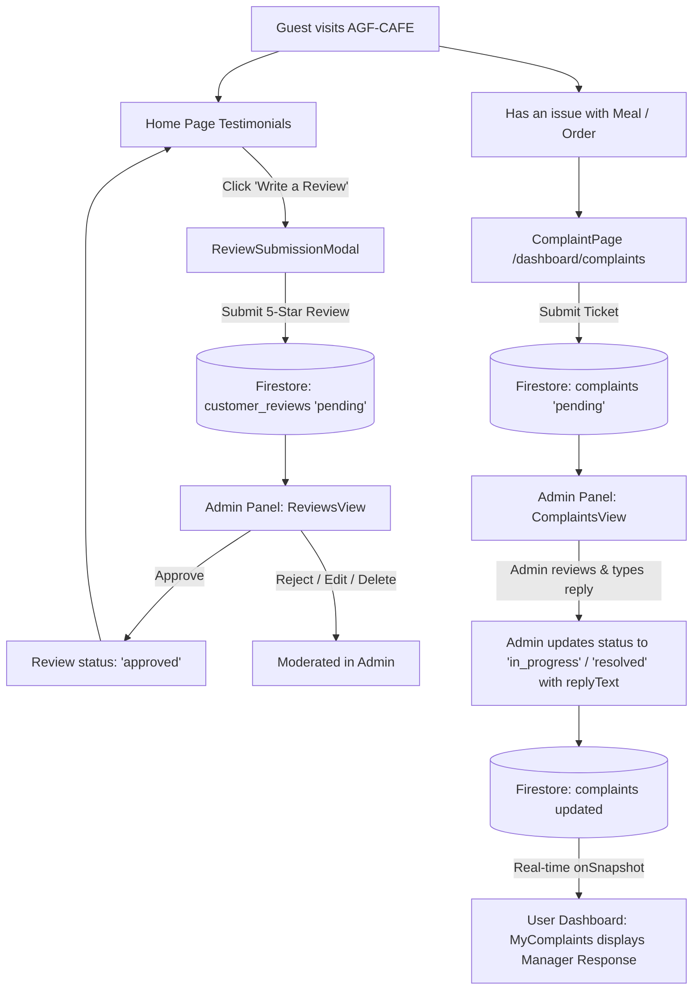

# 📋 Comprehensive Architecture & Implementation Blueprint: Reviews & Complaints System (AGF-CAFE)

This document presents a deep comparative analysis of the **Customer Reviews** and **Support / Complaints** systems from **The Grocery Hub** (User & Admin panels) and defines the exact production architecture and implementation plan for **AGF-CAFE**.

---

## 1. System Overview & Core Philosophy

Both systems bridge the communication gap between cafe guests and the management team:
1. **Public Social Proof (Customer Reviews System)**:
   - Guests share genuine dining experiences and star ratings.
   - All submissions go to a **moderation queue** (`status: 'pending'`).
   - Admin inspects, approves, edits, or rejects reviews.
   - Only **approved** reviews are rendered on the public Cafe homepage (`CustomerReviews` / Testimonials) with verified badges.
   - Admin can also manually add curated reviews with custom ratings, customer names, and locations.

2. **Customer Care & Issue Resolution (Complaints / Support Tickets System)**:
   - When a guest faces an issue (e.g., cold food, missing item, payment discrepancy, delivery partner delay), they lodge a structured support ticket via `/complaint` or `/dashboard/complaints`.
   - Tickets are linked to the user's `uid`, customer phone, and optional `orderId`.
   - Admin monitors the real-time queue with KPI badges (Pending, In Progress, Resolved).
   - Admin writes an **Admin Reply** and updates the ticket status.
   - The guest instantly sees the response in their **User Dashboard ➔ My Complaints** screen.

---

## 2. In-Depth Comparative Analysis (Grocery Hub vs. AGF-CAFE)

### A. Customer Reviews System

| Feature / Aspect | Grocery Hub (`grovery-hub` & dashboard) | AGF-CAFE Enhanced Implementation |
| :--- | :--- | :--- |
| **Submission Modal** | `ReviewSubmissionModal.jsx` (white modal, 5 stars, name, email, review, sends `status: 'pending'`) | `ReviewSubmissionModal.jsx` (Dark luxury glassmorphism `#101216`, gold stars `#f59e0b`, auto-prefill from `useAuth`, cafe food quality tags, dishes enjoyed) |
| **Public Display** | `Testimonials.jsx` (GSAP scroll, queries `customer_reviews` where `status == 'approved'`, avatar generation via UI-avatars) | `CustomerReviews.jsx` (Dark aesthetic, live Firestore query with graceful fallback to curated cafe favorites, star rating breakdown, "Write a Review" button) |
| **Admin View** | `ReviewsView.jsx` (Tabs: Pending, Approved, Rejected; Search; Inline Approve/Reject; Edit Modal; Add Review Modal; Delete) | `ReviewsView.jsx` (Clean luxury admin UI, Pending/Approved/Rejected counts, quick star rating editor, direct response capability, delete confirmation) |
| **Firestore Schema** | `customer_reviews`: `{ userId, userName, userEmail, rating, comment, status, location, createdAt }` | `customer_reviews`: `{ userId, userName, userEmail, userPhoto, rating, comment, status, location, favoriteDish, createdAt, updatedAt }` |

---

### B. Customer Complaints & Support Tickets System

| Feature / Aspect | Grocery Hub (`grovery-hub` & dashboard) | AGF-CAFE Enhanced Implementation |
| :--- | :--- | :--- |
| **Lodge Complaint Page** | `/complaint` (`ComplaintPage.jsx`: Name, phone, orderId, issueType, description) | `/complaint` (Dark luxury theme, pre-fills active user profile, Order ID selection from user's recent orders, food-specific categories: Food Quality, Missing Item, Packaging, Delivery Delay, Billing) |
| **User Dashboard** | `/dashboard/complaints` (`MyComplaints.jsx`: real-time onSnapshot by `userId` and `phone`, lists tickets, shows `adminReply`) | `/dashboard/complaints` (`MyComplaints.jsx`: Live Firestore listener, luxury ticket cards with gold/emerald status badges, manager reply box with timestamp and Cafe Manager signature) |
| **Admin Queue** | `ComplaintsView.jsx` (Stat cards, Search, Status filter, Category filter, table with phone links, Detail Modal with Admin Reply input and resolution status buttons) | `ComplaintsView.jsx` (Integrated into Admin navigation with live pending count badge, search by name/phone/order/issue, priority tags, quick dial link, direct reply box, status transitions) |
| **Firestore Schema** | `complaints`: `{ name, phone, orderId, issueType, description, userId, status, adminReply, createdAt, updatedAt }` | `complaints`: `{ ticketId, name, phone, userEmail, orderId, issueType, description, userId, status: 'pending'|'in_progress'|'resolved'|'dismissed', adminReply, adminReplyAt, createdAt, updatedAt }` |

---

## 3. Data Schemas (Firestore)

### 1. `customer_reviews` Collection
```typescript
interface CustomerReview {
  id: string;                      // Auto-generated Firestore Document ID
  userId: string;                  // Firebase Auth UID or 'guest' / 'admin'
  userName: string;                // Customer full name
  userEmail?: string;              // Customer email
  userPhoto?: string;              // Avatar URL (or UI-Avatars fallback)
  rating: number;                  // 1 to 5 integer
  comment: string;                 // Detailed review text
  favoriteDish?: string;           // Optional dish name e.g. "Hazelnut Cappuccino"
  location: string;                // e.g. "Baharagora, Jharkhand"
  status: 'pending' | 'approved' | 'rejected'; // Moderation state
  createdAt: Timestamp;            // serverTimestamp()
  updatedAt?: Timestamp;           // serverTimestamp()
}
```

### 2. `complaints` Collection
```typescript
interface ComplaintTicket {
  id: string;                      // Auto-generated Firestore Document ID
  ticketId: string;                // Human-readable code e.g. "TKT-82910"
  userId: string;                  // Firebase Auth UID or 'guest'
  userEmail?: string;              // Customer email
  name: string;                    // Customer Name
  phone: string;                   // Contact phone
  orderId?: string;                // Related Cafe Order ID e.g. "AGF-928174"
  issueType:                       // Categorized complaint reason
    | 'Food Quality'
    | 'Missing Item'
    | 'Packaging Issue'
    | 'Delivery Delay'
    | 'Billing / Payment'
    | 'App / Technical Bug'
    | 'Other';
  description: string;             // Detailed explanation of the issue
  status: 'pending' | 'in_progress' | 'resolved' | 'dismissed';
  adminReply?: string;             // Official response from Cafe Manager
  adminReplyAt?: Timestamp;        // When the manager replied
  resolvedAt?: Timestamp;          // When the ticket was closed
  createdAt: Timestamp;            // serverTimestamp()
  updatedAt: Timestamp;            // serverTimestamp()
}
```

---

## 4. UI/UX & Flow Specifications



---

## 5. Implementation Action Plan

### Phase 1: User Panel (`c:\Users\ghosh\AGF-CAFE\user`)
1. **`ReviewSubmissionModal.jsx`**:
   - Create in `src/features/reviews-trust/components/ReviewSubmissionModal.jsx`.
   - Dark luxury styling (`bg-stone-900`, `border-stone-800`, amber stars, pre-filled user info).
   - Validates rating and name, writes to `customer_reviews` with `status: 'pending'`.
2. **`CustomerReviews.jsx`**:
   - Update in `src/features/reviews-trust/components/CustomerReviews.jsx`.
   - Real-time or async fetch of `status == 'approved'` reviews from `customer_reviews`.
   - Fallback to high-quality curated cafe testimonials if collection is new.
   - Prominent **"Write a Review"** button with pen icon to open `ReviewSubmissionModal`.
3. **`ComplaintPage.jsx`**:
   - Refine `src/pages/ComplaintPage.jsx` to match cafe categories, generate `#TKT-XXXXXX` ticket ID, and redirect to dashboard complaints upon submission.
4. **`MyComplaints.jsx`**:
   - Refine `src/pages/dashboard/MyComplaints.jsx` to live-sync with Firestore by `userId` and `phone`, render stylish tickets, and clearly highlight Manager Responses.

### Phase 2: Admin Panel (`c:\Users\ghosh\AGF-CAFE\admin`)
1. **`ReviewsView.jsx`**:
   - Create `src/components/reviews/ReviewsView.jsx`.
   - Tabs: `Pending`, `Approved`, `Rejected` with live counts.
   - Search by user name or comment.
   - Actions: Approve, Reject, Edit Review Modal, Add Manual Review Modal, Delete.
2. **`ComplaintsView.jsx`**:
   - Create `src/components/complaints/ComplaintsView.jsx`.
   - 4 Top KPI Stat cards: Total Tickets, Pending Review, In Investigation, Resolved.
   - Search by customer name, phone, orderId, or issue text.
   - Filter by Status and Issue Type.
   - Full data table with customer contact, issue badge, order link, relative timing, inline status selector.
   - Complaint Detail Modal with Customer Description, Admin Reply textarea, and 1-click status update buttons ("Mark In Progress", "Mark Resolved").
3. **Navigation & Routing Integration**:
   - Add `Reviews` and `Complaints` to `MAIN_NAV_ITEMS` in `constants/navigation.js` and `Sidebar.jsx`.
   - Dynamically calculate and display pending badges in the sidebar.
   - Connect both views in `App.jsx`.
